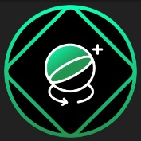

<!-- ===================== HERO ===================== -->

  
  
  

---

## ✦ A little about me

🎓 **B.Tech student in Artificial Intelligence & Machine Learning**  
🧠 Interested in **machine learning, data engineering, and practical AI applications**  
🛠️ I enjoy turning ideas into projects, experimenting with tools, and learning by building  
🌱 Always exploring new technologies and contributing to open source  
💼 **Open to opportunities**  
📬 **Email:** [varunfatehpuria2@gmail.com](mailto:varunfatehpuria2@gmail.com)

---

## 🎨 My tech palette

### Languages

### Tools & workflow

### Libraries & ecosystem

---

## 🚀 What I'm exploring

<table>
  <tr>
    <td width="50%">
      <h3>🤖 Machine Learning</h3>
      Building and experimenting with models for real-world problems.
    </td>
    <td width="50%">
      <h3>📊 Data Engineering</h3>
      Learning to create reliable data workflows and pipelines.
    </td>
  </tr>
  <tr>
    <td width="50%">
      <h3>🐍 Python Automation</h3>
      Writing scripts that make repetitive work easier.
    </td>
    <td width="50%">
      <h3>🌐 AI Applications</h3>
      Exploring applications that connect models, data, and user-facing software.
    </td>
  </tr>
</table>

---

## 📈 GitHub at a glance

 

---

## 🏅 Milestones & community

**Unity Learn Badge**

  

**Holopin Badges**

---

## 🌐 Find me around the web

---

### ✨ Thanks for stopping by

If something here catches your eye, explore a repository, share feedback, or collaborate with me.

